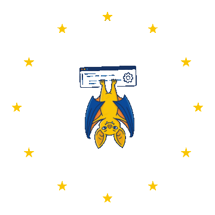
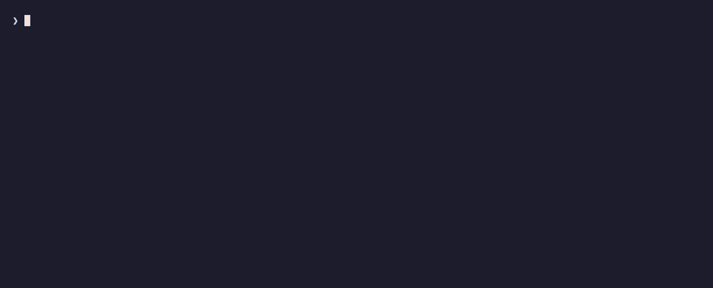
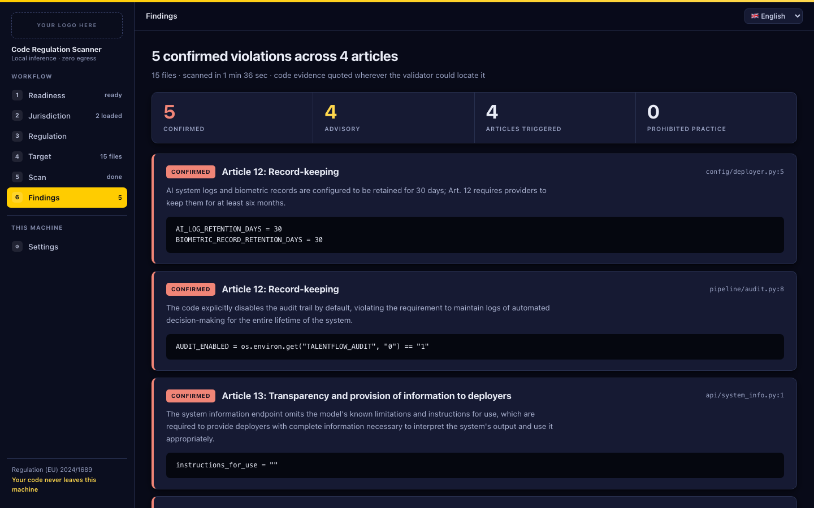

<!--
SPDX-FileCopyrightText: 2026 Alexandru Girlea

SPDX-License-Identifier: Apache-2.0
-->

<p align="center">
  <picture>
    <source media="(prefers-color-scheme: dark)" srcset="https://raw.githubusercontent.com/AlexandruGirlea/precommiteu/main/docs/assets/img/bat-hero-dark.png">
    
  </picture>
</p>

<h1 align="center">precommitEU</h1>

<p align="center">
  <strong>Air-gapped GenAI scanning for EU regulatory risks.<br>
  Your code. Your infrastructure. Your control. Free and open source.</strong>
</p>

<p align="center">
  One local scanner, eight EU regulations: GDPR, the EU AI Act, NIS2, DORA, the
  Cyber Resilience Act, the Digital Services Act, the Digital Markets Act and
  the Data Act.
</p>

<p align="center">
  <a href="https://www.bestpractices.dev/projects/14178"></a>
  <a href="https://api.reuse.software/info/github.com/AlexandruGirlea/precommiteu"></a>
</p>

<p align="center">
  <a href="https://alexandrugirlea.github.io/precommiteu/"><strong>Documentation</strong></a>
  &nbsp;&middot;&nbsp;
  <a href="https://alexandrugirlea.github.io/precommiteu/install.html">Install</a>
  &nbsp;&middot;&nbsp;
  <a href="https://alexandrugirlea.github.io/precommiteu/ui.html">Local UI</a>
  &nbsp;&middot;&nbsp;
  <a href="https://alexandrugirlea.github.io/precommiteu-ops/"><strong>Ops docs · Deploy to CI</strong></a>
  &nbsp;&middot;&nbsp;
  <a href="https://alexandrugirlea.github.io/precommiteu/cli.html">CLI reference</a>
  &nbsp;&middot;&nbsp;
  <a href="https://huggingface.co/AlexandruGirlea/precommiteu-models">Model bundle</a>
  &nbsp;&middot;&nbsp;
  <a href="https://precommit.eu">precommit.eu</a>
</p>

precommitEU uses generative AI to review source code, follow relevant code
across files, and report potential EU regulatory violations with quoted
evidence. **The scanner and model weights are available under Apache-2.0.**
**Scan without internet access after installation.** Download or transfer
the scanner, llama.cpp runtime and model bundle once; every model then runs
inside your own environment, including on an air-gapped machine. There is
no external LLM API, API key, subscription or per-scan licence fee.
See the [air-gapped installation guide](https://alexandrugirlea.github.io/precommiteu/install.html#air-gapped-and-offline-installation).

| Start locally | Deploy for your team |
|---|---|
| [Try the CLI or local UI](https://alexandrugirlea.github.io/precommiteu/install.html) on a 32 GB laptop. | [precommitEU ops](https://github.com/AlexandruGirlea/precommiteu-ops) adds Azure GPU runners to GitHub Actions through Terraform or Pulumi. |

The software is free; you provide the compute. Ops documents the
[deployment costs and timings](https://alexandrugirlea.github.io/precommiteu-ops/performance.html).
Its GitHub Actions deployment uses local inference but requires GitHub
connectivity; the scanner itself can operate fully offline.

<p align="center">
  
</p>

A real scan, unedited: about 80 seconds on an M-series MacBook, played back at
5&times;. `models.py` holds only a dataclass, so the detector clears it and the
validator is never called. `user_store.py` mentions a sibling file, so the
orchestrator takes over: it resolves `UserProfile` into `models.py`, finds that
`audit_line()` interpolates a national ID and a home address, and confirms a
GDPR Art. 32 violation by connecting the log line to the data in the sibling
file.

**[Replay this scan in your browser](https://precommit.eu/try)**. No install,
nothing to upload.

```bash
export PRECOMMITEU_MODELS_DIR=~/.precommiteu/models
precommiteu scan src/ --fail-on-findings
```

## What's new in 0.3

Version 0.3 adds a larger local model for validation and cross-file reasoning.
In our 450-case evaluation, it achieved **95.5% case-level precision and a 4%
false-positive rate on clean cases**. DSA and the combined CRA/DMA/NIS2 pack
raised no false alarms in their samples, compared with 15% and 5% in the older
README results. Gains vary by pack; see [Detection quality](#detection-quality)
for the recall tradeoffs and evaluation limits.

That comes at a hardware cost: **32 GB RAM and about 23 GB of model files**.
It still runs locally on a 32 GB laptop, including Apple Silicon, but standard
GitHub-hosted runners are too small. GitHub Actions remains supported with a
self-hosted runner. For CI, [precommitEU ops](https://github.com/AlexandruGirlea/precommiteu-ops)
provides the Azure T4 GPU infrastructure through Terraform or Pulumi.

## Local UI

**New in 0.2.** A local web UI ships with the package. Point it at a folder and
watch the run: readiness checks, the plan, per-file progress and ETA, then
confirmed findings and advisories. It drives the same scanner as a subprocess
and writes nothing into the folder being scanned.

<p align="center">
  
</p>

```bash
pip install "precommiteu[ui]"
precommiteu ui
```

That serves `http://127.0.0.1:8787` and nothing else. You pick what to scan
from the Target screen: a folder on this machine, or a repository URL it
clones for you. The scanner never touches anything until you do.

Nothing else to install by hand either. The readiness screen installs what is
missing where it can, and the regulation screen downloads adapter packs on
demand, verifying each against the bundle checksums. One pack is active at a
time; picking another switches it.

The Target screen knows what was already analysed: scan only the changed files,
start clean and rescan everything, or forget the cached findings for that
folder. The Settings screen shows where this machine keeps the model bundle,
the scan cache and the reports, and moves any of the three without a restart.
Available in English, Romanian, German, French and Italian.

Every screen, the download flow, pause versus stop, and what the UI sends over
the network: **[Local UI](https://alexandrugirlea.github.io/precommiteu/ui.html)**.

## The Zen of EU Code

1. Put purpose before collection.
2. Collect less than you could, and keep it for less time.
3. Let people know what the system knows.
4. Make consent a choice, not a trap.
5. Give people working controls over their data.
6. Protect what you keep, from design to update.
7. Children deserve stronger defaults.
8. Explain automated decisions before they become consequences.
9. Build systems that fail safely, recover clearly, and report harm responsibly.
10. Make switching, portability, and interoperability real.

*Run `precommiteu this` to print it.*

## Quick start

```bash
brew install llama.cpp
pip install precommiteu==0.3.2 huggingface_hub
hf download AlexandruGirlea/precommiteu-models base.gguf orchestrator.gguf gdpr/detector-adapter.gguf SHA256SUMS LICENSE.Apache-2.0.txt NOTICE --revision v0.3.0 --local-dir ~/.precommiteu/models
export PRECOMMITEU_MODELS_DIR=~/.precommiteu/models
precommiteu scan src/
```

The models need 32 GB of RAM and about 23 GB of disk.

Linux, source and GPU builds, downloading more packs, air-gapped installs and
uninstall: **[Installation](https://alexandrugirlea.github.io/precommiteu/install.html)**.

`hf download` writes the bundle in the layout the scanner expects. Each
adapter must sit in a directory named exactly after its pack, because the
scanner resolves `<models-dir>/<regulation>/detector-adapter.gguf`:

```text
~/.precommiteu/models/
├── orchestrator.gguf                # orchestrator and validator
├── base.gguf                        # detector base, shared by every regulation
├── gdpr/detector-adapter.gguf
└── eu_ai_act/detector-adapter.gguf  # one directory per pack you downloaded
```

A flat directory does not work: both shared models and every selected
regulation's adapter are required. A missing file stops the scan.

```bash
precommiteu scan src/ --regulations gdpr,eu_ai_act    # several regulations
precommiteu scan --ci --fail-on-findings              # changed files only, gate the build
```

### From Python

```python
import os
from precommiteu import scan_paths

# Required unless you pass models_dir to scan_paths.
os.environ["PRECOMMITEU_MODELS_DIR"] = "~/.precommiteu/models"

result = scan_paths(["src/"], regulations=("gdpr",))
for finding in result.findings:
    print(finding.regulation, finding.file,
          finding.probable_article_id, finding.description)
```

Full API reference, every parameter, the result schemas and streaming
callbacks: **[Python library](https://alexandrugirlea.github.io/precommiteu/library.html)**.

## How it works

- **Your code never leaves your machine.** All analysis runs on local
  `llama-server` processes the scanner starts and stops itself. No cloud, no
  telemetry, no network egress.
- **Confirmed findings quote code evidence.** A detector proposes candidates;
  a validator then has to locate the quoted evidence verbatim in your file, or the
  candidate is dropped. Confirmed findings cite the line. Candidates that fail
  validation are reported as advisories: clearly labeled, never gating. Only
  confirmed findings can fail a build.
- **Deterministic where it matters.** Grammar-constrained model output,
  fixed budgets per file, suppression rules with auditable reasons.
- **Only what changed.** Every file that completes cleanly is recorded, and the
  next scan of the same folder replays it instead of analysing it again, so a
  repository that took hours the first time takes minutes when a handful of
  files moved. The record is one small JSON file per folder and regulation
  under `~/.precommiteu/scans/`; nothing is written into the folder you scan.
  `--rescan-all` forces a full pass. Reuse rules, change detection and CI
  behaviour:
  [Incremental rescans](https://alexandrugirlea.github.io/precommiteu/cli.html#incremental-rescans).

## Model bundle

precommitEU ships as two artifacts. The scanner is a pure-Python wheel on
PyPI; the weights are published separately on Hugging Face at
[AlexandruGirlea/precommiteu-models](https://huggingface.co/AlexandruGirlea/precommiteu-models)
(public, no token needed). `pip install` does **not** fetch them.

The repository holds eight model files: a 16.5 GiB `orchestrator.gguf` that runs
the orchestrator and validator, a 4.36 GiB `base.gguf` that every detector
adapter loads onto, plus a 77 MiB detector adapter per pack. **You choose which
adapters to download.** Name the files you want, or omit them to take
everything:

```bash
# shared models + GDPR only, about 22.5 GB
hf download AlexandruGirlea/precommiteu-models base.gguf orchestrator.gguf gdpr/detector-adapter.gguf SHA256SUMS LICENSE.Apache-2.0.txt NOTICE --revision v0.3.0 --local-dir ~/.precommiteu/models

# add another pack later, the shared models are already there
hf download AlexandruGirlea/precommiteu-models eu_ai_act/detector-adapter.gguf --revision v0.3.0 --local-dir ~/.precommiteu/models

# everything, about 22.9 GB
hf download AlexandruGirlea/precommiteu-models --revision v0.3.0 --local-dir ~/.precommiteu/models
```

`--regulations` picks which downloaded packs to run. Every selected pack's
adapter must be present; a missing adapter stops the scan before models load.

Air-gapped installs, checksum verification and uninstall:
[Installation](https://alexandrugirlea.github.io/precommiteu/install.html).

## Regulation packs

Eight EU regulations, shipped as six adapter packs. `gdpr` is the default and
the sensible one for almost any product repo.

| `--regulations` value | Covers |
|---|---|
| `gdpr` *(default)* | General Data Protection Regulation |
| `eu_ai_act` | Artificial Intelligence Act |
| `eu_data_act` | Data Act |
| `dora` | Digital Operational Resilience Act |
| `dsa` | Digital Services Act |
| `cra_dma_nis2` | Cyber Resilience Act, Digital Markets Act and NIS2 |

```bash
precommiteu scan src/ --regulations gdpr,eu_ai_act
```

Each adapter is trained on code its own regulation governs, so scanning with
all six is noisier rather than more thorough. Application dates, what each pack
is for, and how several packs run in one scan are in
[Regulation packs](https://alexandrugirlea.github.io/precommiteu/regulations.html).

## Detection quality

The 3 November 2026 evaluation used a 0.3.0 wheel and the released 0.3.x model
bundle on 450 balanced synthetic cases. These are **case-level** results:
whether a file raised any confirmed finding, excluding advisories.

| Pack | Precision | Recall | False positive rate |
|---|---|---|---|
| `gdpr` | 92% | 92% | 8% |
| `eu_ai_act` | 94% | 64% | 4% |
| `eu_data_act` | 96% | 92% | 4% |
| `cra_dma_nis2` | 100% | 88% | 0% |
| `dsa` | 100% | 92% | 0% |
| `dora` | 96% | 88% | 4% |
| All nine evaluated datasets | **95.5%** | **85.7%** | **4%** |

Compared with the older README results, DSA and CRA/DMA/NIS2 show the clearest
false-alarm reductions. EU AI Act and Data Act fall from 5% to 4%. GDPR rises
from 6% to 8%, and DORA from 0% to 4%; EU AI Act recall falls from 93% to 64%.
The older runs used different samples, so this is a historical comparison,
not a controlled measurement of the model change alone.

The aggregate includes separate CRA, DMA and NIS2 datasets as well as the
combined pack: 450 runs, 440 unique snippets. False-positive rate means 9 of
225 clean cases were flagged; 9 of 201 flagged cases were false alarms (4.5%).
One positive case failed to complete: recall is 85.7% on completed positives,
or 85.3% counting that failure as a miss. Exact article sets matched in 79.1%
of all cases. A clean scan is not compliance sign-off.

Method, counts and limitations:
[Detection evaluation](https://alexandrugirlea.github.io/precommiteu/detection-evaluation.html).

## In CI

Deploy [precommitEU ops](https://github.com/AlexandruGirlea/precommiteu-ops)
with Terraform or Pulumi, then wait for its model download job to succeed.
It supplies an ephemeral GitHub Actions runner on an Azure T4 GPU with
scanner 0.3.2 and models v0.3.0 already available. Add this workflow to a
private repository:

```yaml
name: compliance-scan
on: pull_request
permissions:
  contents: read
jobs:
  precommiteu:
    runs-on: [self-hosted, precommiteu]
    timeout-minutes: 60
    steps:
      - uses: actions/checkout@v4
        with:
          fetch-depth: 0
      - uses: AlexandruGirlea/precommiteu@v0.3.2
        with:
          regulations: gdpr
      - uses: actions/upload-artifact@v4
        if: ${{ !cancelled() }}
        with:
          name: precommiteu-reports
          path: |
            precommiteu.sarif
            precommiteu-summary.md
```

`--ci` scans only the files changed against the merge-target branch. Exit code
`1` on confirmed findings with `--fail-on-findings`, `0` when clean, and `3`
when analysis is incomplete. Make this job a required status check to gate
merges. The [ops documentation](https://alexandrugirlea.github.io/precommiteu-ops/)
includes deployment steps, measured timings and estimated Azure costs.
Existing runner setup, GitLab, Azure DevOps, inputs and every exit code
are in [CI integration](https://alexandrugirlea.github.io/precommiteu/ci.html).

## Documentation

| Guide | Contents |
|---|---|
| [Installation](https://alexandrugirlea.github.io/precommiteu/install.html) | Requirements, per-platform install, model bundle download, CPU vs GPU, verify, uninstall |
| [Local UI](https://alexandrugirlea.github.io/precommiteu/ui.html) | The six steps, downloading packs, pause vs stop, settings, what leaves the machine |
| [CLI reference](https://alexandrugirlea.github.io/precommiteu/cli.html) | CLI usage, complete flag reference, reports, suppressions |
| [Regulation packs](https://alexandrugirlea.github.io/precommiteu/regulations.html) | The six packs, application dates, choosing packs, multi-regulation runs |
| [CI integration](https://alexandrugirlea.github.io/precommiteu/ci.html) | The CI container, GitHub Actions, GitLab, Azure DevOps, exit codes |
| [precommitEU ops](https://github.com/AlexandruGirlea/precommiteu-ops) | Deploy Azure GPU runners with Terraform or Pulumi; setup, workflows and costs |
| [Python library](https://alexandrugirlea.github.io/precommiteu/library.html) | Python API: `scan_paths`, `scan_diff`, schemas, callbacks |
| [Report reference](https://alexandrugirlea.github.io/precommiteu/reports.html) | Report formats: JSON field reference, SARIF, summary, ledger |
| [Ignoring and suppressing](https://alexandrugirlea.github.io/precommiteu/suppressions.html) | `.eu-ignore`, inline `eu-ignore` directives, audited `precommiteu-ignore` markers |
| [Examples](https://alexandrugirlea.github.io/precommiteu/examples.html) | Worked scans, real output, common flag combinations |
| [Troubleshooting](https://alexandrugirlea.github.io/precommiteu/troubleshooting.html) | Model paths, `llama-server` startup, empty scans, error messages |

Rendered documentation site: <https://alexandrugirlea.github.io/precommiteu/>
Project site: <https://precommit.eu>

## Disclaimer

precommitEU is free and fully open source under the Apache License 2.0, and is
provided **as is**, without warranty or condition of any kind, express or
implied, as set out in sections 7 and 8 of that license. Use is entirely at
your own risk. There is no service level, no availability commitment and no
guarantee of accuracy or fitness for any purpose.

It produces a compliance signal, not legal advice: it can report findings that
are not violations and can miss violations that are present. Nothing it
outputs establishes, certifies or evidences compliance with any regulation.

The author is not a lawyer and provides no legal, regulatory or compliance
advice. This software does not replace legal analysis. To the maximum extent
permitted by applicable law, Alexandru Girlea accepts no liability for any
damages, losses, costs, regulatory outcome or misrepresentation arising from
use of this software or reliance on its output. Have findings reviewed by
qualified legal counsel before acting on them.

## License

Apache License 2.0, see
[LICENSE](https://github.com/AlexandruGirlea/precommiteu/blob/main/LICENSE),
[NOTICE](https://github.com/AlexandruGirlea/precommiteu/blob/main/NOTICE) and
[THIRD_PARTY_NOTICES.md](https://github.com/AlexandruGirlea/precommiteu/blob/main/THIRD_PARTY_NOTICES.md).
Copyright (c) 2026 Alexandru Girlea.

Everything precommitEU produces is Apache-2.0: the scanner, the
per-regulation LoRA detector adapters, the GBNF grammars and the regulation
knowledge packs, including everything in the
[model bundle](https://huggingface.co/AlexandruGirlea/precommiteu-models).
The base model weights (Qwen 2.5 Coder, Apache-2.0) and the `llama-server`
binary (llama.cpp, MIT) are delivered separately and carry their own
licenses.
